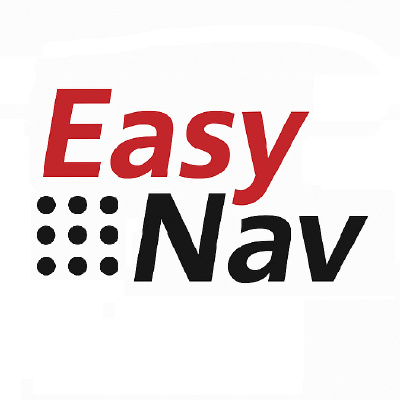

:hide-toc:

.. _documentation_home:

.. rst-class:: en-home

*****
|LPN|
*****

.. raw:: html

   

     

       Open-source navigation for ROS 2
       <h1>Robots navigating in minutes, <em>predictable</em> on real hardware</h1>
       
EasyNavigation is a modular, real-time and representation-agnostic navigation system:
          costmaps, NavMap 3D surfaces or Bonxai voxel maps, one binary and one parameter file.

       <a class="md-button md-button--primary" href="getting_started/index.html">Get started</a>
       <a class="md-button" href="playgrounds/index.html">Try a PlayGround</a>
       <a class="md-button" href="plugins/index.html">Browse the plugins</a>
     

     

   

   

     
3Map representations

     
23Navigation plugins

     
6Simulated PlayGrounds

     
4ROS 2 distributions

   

Where do you want to start?
###########################

.. raw:: html

   

     <a class="en-card" href="getting_started/index.html">
       🚀New to EasyNav
       Install it and get a simulated robot navigating with a single launch file.
       Getting started →</a>
     <a class="en-card" href="howtos/index.html">
       🧪Research and teaching
       Swap planners, controllers, localizers and maps, and compare methods on the same robot.
       HowTos →</a>
     <a class="en-card" href="developer_guide/safety.html">
       🛡️Industry and real robots
       Safety mode, real-time monitoring, heartbeat and recovery for deployments.
       Safety mode →</a>
     <a class="en-card" href="developer_guide/index.html">
       🧩Plugin developers
       Learn the core design and the blackboard, and write your own plugins.
       Developers guide →</a>
   

Overview
########

**EasyNavigation (EasyNav)** is an open-source navigation system for ROS 2, designed to be:

.. raw:: html

   

     
<i class="en-feature__dot"></i>
<b>Representation-agnostic</b>
       2D costmaps, NavMap 3D navigable surfaces, Bonxai probabilistic voxel maps, or hybrid combinations.

     
<i class="en-feature__dot"></i>
<b>Real-time capable</b>
       Minimal latency between perception and action.

     
<i class="en-feature__dot"></i>
<b>Modular</b>
       A plugin architecture and reusable navigation stacks.

     
<i class="en-feature__dot"></i>
<b>Lightweight and simple to deploy</b>
       A single binary and a parameter file for configuration.

     
<i class="en-feature__dot"></i>
<b>Simulation-ready</b>
       A rich collection of PlayGrounds with different robots and environments.

     
<i class="en-feature__dot"></i>
<b>Built for safety and runtime reconfiguration</b>
       <a href="developer_guide/safety.html">Safety mode</a> next to a certified safety channel, and a
       <a href="developer_guide/recovery.html">recovery system</a> that detects failures and reacts to them.

     
<i class="en-feature__dot"></i>
<b>Ready for every user</b>
       Hobbyists, academia and research labs, and industry that needs predictable, safe behavior.

   

EasyNav is developed by the `Intelligent Robotics Lab <https://intelligentroboticslab.gsyc.urjc.es/>`_ at Universidad Rey Juan Carlos and aims to be a flexible, extensible, and practical alternative to existing ROS 2 navigation stacks like Nav2.

We believe in Open Source and in giving the community multiple options to choose from, that adapt to different scenarios and constraints. **EasyNav is not intended to replace Nav2**, which we admire and take as inspiration. Instead, it aims to offer flexibility and meet specific requirements in areas where Nav2 might be less suitable.

How the pieces fit
##################

.. raw:: html

   

     
<b>Core</b>
       Real-time data processing and behavior execution.

     
<b>Stacks</b>
       Specialize the system for different environment types or use cases.

     
<b><a href="plugins/index.html">Plugins</a></b>
       Localization, path planning, control and map representation methods.

     
<b><a href="playgrounds/index.html">PlayGrounds</a></b>
       Complete simulations with robots, maps and example configurations.

   

Whether you are building robots for indoor or outdoor environments, structured or unstructured terrains, EasyNav provides the flexibility and performance needed to achieve robust autonomous navigation.

See it running
##############

.. raw:: html

   

     <iframe src="https://www.youtube.com/embed/MssaLixuv2g?mute=1" title="EasyNav video 1" allowfullscreen loading="lazy"></iframe>
     <iframe src="https://www.youtube.com/embed/1GeKgw3Pbr4?mute=1" title="EasyNav video 2" allowfullscreen loading="lazy"></iframe>
   

Get involved
############

📚 Learn more about the contributors and project organization in :ref:`about`.

📦 Source code: `github.com/EasyNavigation/EasyNavigation <https://github.com/EasyNavigation/EasyNavigation>`_

If you use this software in your work, please consider citing our next paper.

.. raw:: html

   

     
<b>Want to contribute?</b> Open an issue, suggest a feature, or submit a pull request.

     <a class="md-button md-button--primary" href="https://github.com/EasyNavigation/EasyNavigation">Contribute on GitHub</a>
   

.. toctree::
   :hidden:

   build_install/index.rst
   getting_started/index.rst
   playgrounds/index.rst
   plugins/index.rst
   howtos/index.rst
   developer_guide/index.rst
   migration_guide/index.rst
   about/index.rst
