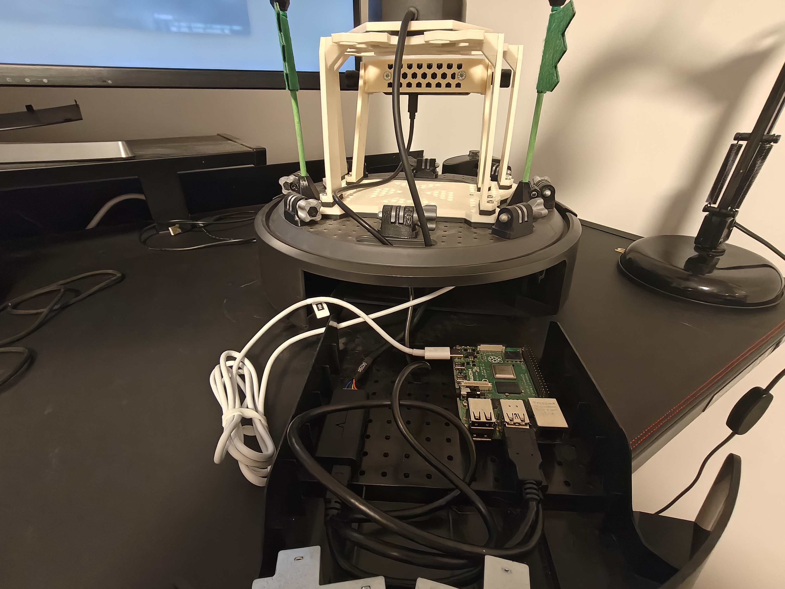

.. _robot_icreate3:

========
iCreate3
========

An **iRobot iCreate3** with a 2D lidar and a Raspberry Pi running EasyNav on ROS 2 Kilted, navigating
in a house with the Costmap stack. This page gathers its hardware, its EasyNav parameter files
(one per controller: RPP, MPPI and MPC) and its launchers. To set up the robot, build the map and
deploy EasyNav on it, see :doc:`../howtos/costmap_navigating_with_icreate`.

.. image:: ../images/base_icreate.jpg
   :align: center
   :alt: iCreate3 base

Hardware
--------

.. list-table::
   :header-rows: 1
   :widths: 22 78

   * - Component
     - Details
   * - Base
     - `iRobot iCreate3 <https://edu.irobot.com/create3-setup>`_, with the ROS 2 Iron firmware with
       Fast DDS (https://edu.irobot.com/create3-latest-fw).
   * - Lidar
     - `RPLidar S2 <https://www.slamtec.com/en/S2>`_ mounted on top of the base, connected to the
       Raspberry Pi via USB (driver: ``sllidar_ros2``).
   * - On-board computer
     - Raspberry Pi 4 Model B powered from the base via USB-C, with **Ubuntu 24.04 Desktop** and
       **ROS 2 Kilted**. It communicates with the base and the laptop over Wi-Fi.
   * - Operator laptop
     - Runs ``rviz2`` and connects to the Raspberry Pi via SSH to launch processes.

Launchers
---------

The parameter files and launchers live in a package of the robot, ``easynav_indoor_testcase``,
together with the map of the house (``maps/casa.yaml``). There is one launcher per controller:

.. list-table::
   :header-rows: 1
   :widths: 40 30 30

   * - Launch file
     - Controller
     - Parameter file
   * - ``easynav_icreate3_rpp.launch.yaml``
     - Regulated Pure Pursuit
     - ``icreate3.costmap.rpp.params.yaml``
   * - ``easynav_icreate3_mppi.launch.yaml``
     - MPPI
     - ``icreate3.costmap.mppi.params.yaml``
   * - ``easynav_icreate3_mpc.launch.yaml``
     - MPC
     - ``icreate3.costmap.mpc.params.yaml``

Each of them includes ``easynav_icreate3.launch.yaml``, which starts the lidar driver
(``sllidar_s2_launch.py``), the static transform from ``base_link`` to ``laser`` and EasyNav. On the
Raspberry Pi:

.. code-block:: bash

   ros2 launch easynav_indoor_testcase easynav_icreate3_rpp.launch.yaml

.. list-table::
   :header-rows: 1
   :widths: 25 25 50

   * - Argument
     - Default
     - Description
   * - ``params_file``
     - Per launch file
     - EasyNav parameters file
   * - ``lidar``
     - ``true``
     - Start the RPLidar S2 driver
   * - ``serial_port``
     - ``/dev/ttyUSB0``
     - RPLidar serial port
   * - ``laser_tf``
     - ``true``
     - Publish the static ``base_link`` → ``laser`` transform
   * - ``laser_x``, ``laser_y``, ``laser_z``, ``laser_yaw``
     - ``0.02``, ``0.0``, ``0.22``, ``3.14``
     - Pose of the lidar in ``base_link`` (m, rad)

Things specific to this robot
-----------------------------

- **Limits and geometry.** The iCreate3 tops out at 0.306 m/s: ``robot_limits`` caps the linear
  velocity at 0.3 m/s. ``robot_geometry`` is a circle of 0.17 m radius.
- **Odometry.** The base publishes the ``odom`` → ``base_link`` transform, which AMCL reads
  (``compute_odom_from_tf: true``).
- **Lidar.** The laser has no ``group``: the localizer and the obstacle filter only use the point
  perceptions without one.
- **Localization.** With the dense S2 scan on a real map, the AMCL ``match_score`` is around 0.33
  even when well localized, so ``match_threshold`` is 0.2 in ``amcl_convergence`` and
  ``amcl_relocalize`` (the same value in both). AMCL uses 300 particles and may inject up to 10% of
  random particles (``random_particles_max_fraction``) to escape a wrong pose.
- **Clocks.** The Raspberry Pi has no battery-backed clock: keep it synchronized with NTP (for
  example ``systemd-timesyncd``). A clock offset with the base places the scans with a stale
  transform, and AMCL gets lost as soon as the robot moves.
- **Laptop.** Use the same ROS 2 distribution as the robot on the laptop: some message types are
  not exchanged between different Fast DDS versions (for example Kilted and Rolling).

Configuration files
-------------------

Parameter files
~~~~~~~~~~~~~~~

Regulated Pure Pursuit, :download:`icreate3.costmap.rpp.params.yaml <icreate3/icreate3.costmap.rpp.params.yaml>`:

.. literalinclude:: icreate3/icreate3.costmap.rpp.params.yaml
   :language: yaml

MPPI, :download:`icreate3.costmap.mppi.params.yaml <icreate3/icreate3.costmap.mppi.params.yaml>`:

.. literalinclude:: icreate3/icreate3.costmap.mppi.params.yaml
   :language: yaml

MPC, :download:`icreate3.costmap.mpc.params.yaml <icreate3/icreate3.costmap.mpc.params.yaml>`:

.. literalinclude:: icreate3/icreate3.costmap.mpc.params.yaml
   :language: yaml

Launchers
~~~~~~~~~

The common launcher, :download:`easynav_icreate3.launch.yaml <icreate3/easynav_icreate3.launch.yaml>`:

.. literalinclude:: icreate3/easynav_icreate3.launch.yaml
   :language: yaml

:download:`easynav_icreate3_rpp.launch.yaml <icreate3/easynav_icreate3_rpp.launch.yaml>`:

.. literalinclude:: icreate3/easynav_icreate3_rpp.launch.yaml
   :language: yaml

:download:`easynav_icreate3_mppi.launch.yaml <icreate3/easynav_icreate3_mppi.launch.yaml>`:

.. literalinclude:: icreate3/easynav_icreate3_mppi.launch.yaml
   :language: yaml

:download:`easynav_icreate3_mpc.launch.yaml <icreate3/easynav_icreate3_mpc.launch.yaml>`:

.. literalinclude:: icreate3/easynav_icreate3_mpc.launch.yaml
   :language: yaml
