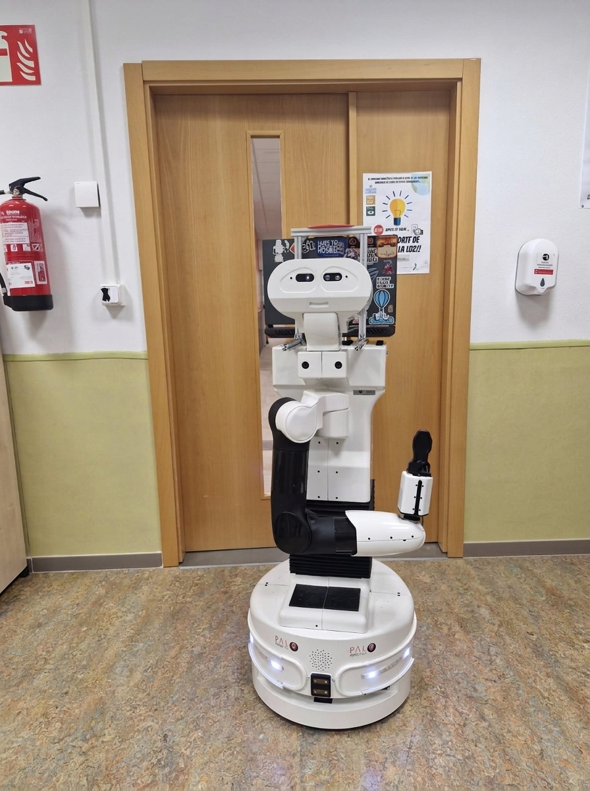
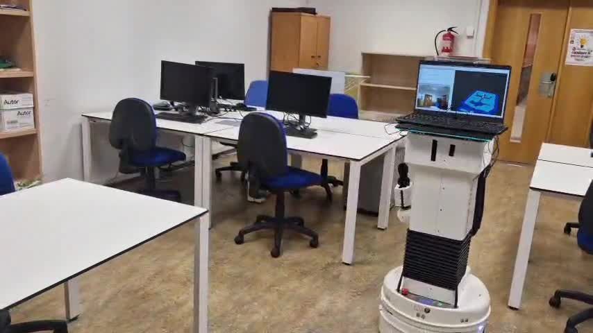

.. _robot_tiago:

=====
TIAGo
=====

A PAL Robotics **TIAGo** with the pmb2 mobile base, running EasyNav (``rolling`` branches) on its
own computer with **ROS 2 Humble**, navigating in a lab with the Costmap stack. This page gathers
its hardware, how EasyNav was built on it, its EasyNav parameter files (one per controller: RPP,
MPPI and MPC) and its launchers. For the simulated TIAGo, see :doc:`tiago`.

Hardware
--------

.. list-table::
   :header-rows: 1
   :widths: 22 78

   * - Component
     - Details
   * - Base
     - PAL Robotics pmb2, differential drive: a 0.50 m diameter cylinder (URDF collision mesh),
       0.404 m wheel separation. Its ``mobile_base_controller`` allows up to 1.0 m/s and 0.5 m/s²
       (linear) and 1.05 rad/s and 1.05 rad/s² (angular).
   * - Lidar
     - SICK TiM561 in the front of the base (``base_laser_link``, 0.202 m ahead of and **0.095 m
       above** ``base_footprint``). PAL's ``laser_scan_footprint_filter`` removes the robot's own body
       from ``/scan_raw`` and publishes ``/scan``.
   * - Odometry
     - PAL's laser odometry (``direct_laser_odometry``) publishes ``/direct_laser_odometry/odom`` and
       the ``odom`` → ``base_footprint`` transform. The wheel odometry (``/mobile_base_controller/odom``)
       does not publish TF.
   * - Upper body
     - Lifting torso (0.35 m of travel), 7-DoF arm with the PAL gripper and a pan-tilt head with an
       Orbbec Astra RGBD camera. EasyNav does not use them: keep the arm tucked while navigating.
   * - On-board computer
     - **Ubuntu 22.04** and **ROS 2 Humble**, with Cyclone DDS. EasyNav runs here, from a workspace
       in ``~/easynav_ws``.
   * - Operator laptop
     - Runs ``rviz2`` and connects to the robot via SSH to launch processes. It can ride on the
       robot's laptop tray.

Building EasyNav on Humble
--------------------------

The robot runs ROS 2 Humble, but EasyNav is built from its ``rolling`` branches, from source, in
``~/easynav_ws``. These are the versions on the robot:

.. list-table::
   :header-rows: 1
   :widths: 30 18 52

   * - Repository
     - Branch
     - Version
   * - ``EasyNavigation``
     - ``rolling``
     - 0.5.1 (``89ab42b9``, 2026-11-03)
   * - ``easynav_plugins``
     - ``rolling``
     - 0.5.1 (``3259c1e9``, 2026-11-03)
   * - ``NavMap``
     - ``rolling``
     - 0.7.0 (``8f877bf``, 2026-11-01)
   * - ``yaets``
     - ``rolling``
     - 1.2.0 (``c63e5c3``, 2026-10-10)
   * - ``easynav_indoor_testcase``
     - ``main``
     - 0.0.1 (``c6faae5``, 2026-08-09)
   * - ``vision_msgs``
     - ``humble``
     - 4.1.1, from source
   * - ``geographic_info``
     - ``ros2``
     - 1.0.7, from source

The toolchain is Ubuntu 22.04's: GCC 11.4 and CMake 3.22. The ``rolling`` sources build on Humble
without changes, but some plugins need packages that the robot does not have:

- **MPC controller.** It solves its problem with OSQP, through ``osqp_vendor``: install
  ``ros-humble-osqp-vendor`` (0.2.0, OSQP 0.6) before building it. The controller supports both
  OSQP 0.6 (Humble, Jazzy, Kilted) and 1.0 (Lyrical, Rolling). It is built in ``Release`` by
  default: unoptimized, the problem does not fit in a control cycle.
- **Fusion localizer** (``easynav_fusion_localizer``). It needs ``robot_localization``. This robot
  does not use it: install ``ros-humble-robot-localization`` or skip it with
  ``--packages-skip easynav_fusion_localizer``.

On the robot:

.. code-block:: bash

   sudo apt install ros-humble-osqp-vendor
   source init-pal-env       # ROS 2 Humble, Cyclone DDS and ROS_DOMAIN_ID=1
   cd ~/easynav_ws
   colcon build --symlink-install --packages-skip easynav_fusion_localizer

Or only the controllers and their dependencies:

.. code-block:: bash

   colcon build --symlink-install --packages-up-to \
     easynav_regulated_pp_controller easynav_mppi_controller easynav_mpc_controller

Launchers
---------

The parameter files and launchers live in the ``easynav_indoor_testcase`` package, together with
the map of the lab (``maps/lab_nov_2026.yaml``). There is one launcher per controller:

.. list-table::
   :header-rows: 1
   :widths: 40 30 30

   * - Launch file
     - Controller
     - Parameter file
   * - ``easynav_tiago_rpp.launch.yaml``
     - Regulated Pure Pursuit
     - ``tiago.costmap.rpp.params.yaml``
   * - ``easynav_tiago_mppi.launch.yaml``
     - MPPI
     - ``tiago.costmap.mppi.params.yaml``
   * - ``easynav_tiago_mpc.launch.yaml``
     - MPC
     - ``tiago.costmap.mpc.params.yaml``

.. warning::

   The launchers take their parameter files from the ``easynav_indoor_testcase`` package
   (``robots_params/``), but the files in that package may not be the same as the ones on this
   page. Use the files of this page as the reference: download them and pass them with
   ``params_file``. The same goes for the map, ``lab_nov_2026.yaml``: it is the map of our lab.
   Build the map of yours (see :doc:`../howtos/costmap_mapping`) and set it in ``map_path_file``.

Each of them includes ``easynav_tiago.launch.yaml``, which only starts EasyNav: PAL's bringup
already runs the laser, the robot model (TF) and the laser odometry. On the robot:

.. code-block:: bash

   source init-pal-env
   source ~/easynav_ws/install/setup.bash
   ros2 launch easynav_indoor_testcase easynav_tiago_mpc.launch.yaml

Or with your own parameter file:

.. code-block:: bash

   ros2 launch easynav_indoor_testcase easynav_tiago_mpc.launch.yaml \
     params_file:=/path/to/tiago.costmap.mpc.params.yaml

.. list-table::
   :header-rows: 1
   :widths: 25 30 45

   * - Argument
     - Default
     - Description
   * - ``params_file``
     - Per launch file
     - EasyNav parameters file
   * - ``odom_topic``
     - ``/direct_laser_odometry/odom``
     - Odometry topic AMCL reads (``odom`` is remapped to it)

Things specific to this robot
-----------------------------

- **Limits and geometry.** The base allows 1.0 m/s, but ``robot_limits`` keep the robot at
  0.3 m/s and 0.6 rad/s indoors, with the base's own 0.5 m/s² acceleration. ``robot_geometry`` is
  the base's 0.25 m radius circle, 1.45 m high (the head, with the torso fully up).
- **Laser height.** The laser is 0.095 m above the floor, and EasyNav drops points below 0.1 m by
  default as floor hits: with the defaults, it would not see any obstacle. Every component that
  filters by height lowers it to 0.05 m: the localizer and the obstacles filter (``min_height``),
  MPC (``min_height``), MPPI and RPP (``z_min_filter``).
- **Odometry.** EasyNav uses PAL's laser odometry, the same one that publishes the ``odom`` frame.
  The launcher remaps ``odom`` to ``/direct_laser_odometry/odom``, and AMCL reads it from that topic
  (``compute_odom_from_tf`` stays ``false``).
- **Velocity commands.** EasyNav publishes ``geometry_msgs/Twist`` on ``/cmd_vel``, the
  ``navigation`` input of PAL's ``twist_mux`` (priority 10). The joystick, the keyboard and the web
  GUI have higher priority: they take over the base while they publish, and EasyNav gets it back
  0.5 s after they stop.
- **Controllers.** MPC keeps ``safety_margin: 0.1`` between the base and the obstacles; MPPI
  penalizes rollouts within ``safety_radius: 0.35`` (the 0.25 m radius plus 0.1 m).
- **Recovery.** ``brake_acc`` of the collision reflex is the base's 0.5 m/s²; the obstacle-close
  distance is the radius plus 0.05 m (0.30 m), and the retreat backs up to 0.45 m.
- **Laptop.** Set ``ROS_DOMAIN_ID=1`` and Cyclone DDS (``RMW_IMPLEMENTATION=rmw_cyclonedds_cpp``) on
  the laptop, and use ROS 2 Humble there too if possible: some message types are not exchanged
  between different ROS 2 distributions.

Configuration files
-------------------

Parameter files
~~~~~~~~~~~~~~~

Regulated Pure Pursuit, :download:`tiago.costmap.rpp.params.yaml <tiago_robot/tiago.costmap.rpp.params.yaml>`:

.. literalinclude:: tiago_robot/tiago.costmap.rpp.params.yaml
   :language: yaml

MPPI, :download:`tiago.costmap.mppi.params.yaml <tiago_robot/tiago.costmap.mppi.params.yaml>`:

.. literalinclude:: tiago_robot/tiago.costmap.mppi.params.yaml
   :language: yaml

MPC, :download:`tiago.costmap.mpc.params.yaml <tiago_robot/tiago.costmap.mpc.params.yaml>`:

.. literalinclude:: tiago_robot/tiago.costmap.mpc.params.yaml
   :language: yaml

Launchers
~~~~~~~~~

The common launcher, :download:`easynav_tiago.launch.yaml <tiago_robot/easynav_tiago.launch.yaml>`:

.. literalinclude:: tiago_robot/easynav_tiago.launch.yaml
   :language: yaml

:download:`easynav_tiago_rpp.launch.yaml <tiago_robot/easynav_tiago_rpp.launch.yaml>`:

.. literalinclude:: tiago_robot/easynav_tiago_rpp.launch.yaml
   :language: yaml

:download:`easynav_tiago_mppi.launch.yaml <tiago_robot/easynav_tiago_mppi.launch.yaml>`:

.. literalinclude:: tiago_robot/easynav_tiago_mppi.launch.yaml
   :language: yaml

:download:`easynav_tiago_mpc.launch.yaml <tiago_robot/easynav_tiago_mpc.launch.yaml>`:

.. literalinclude:: tiago_robot/easynav_tiago_mpc.launch.yaml
   :language: yaml
